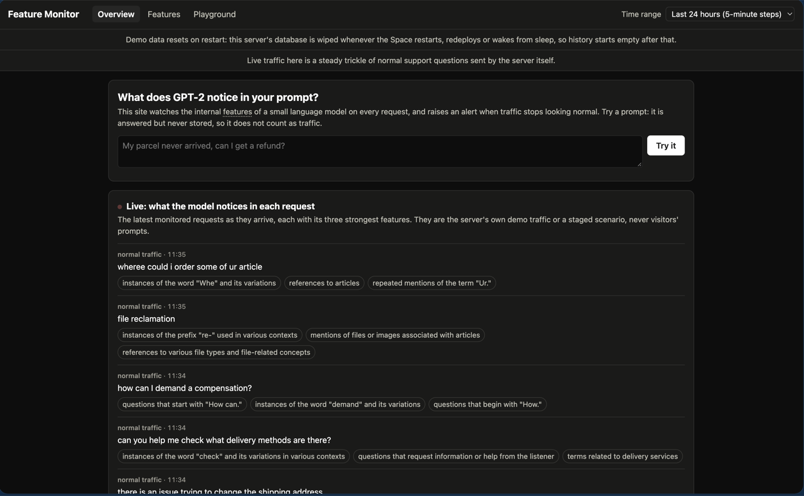
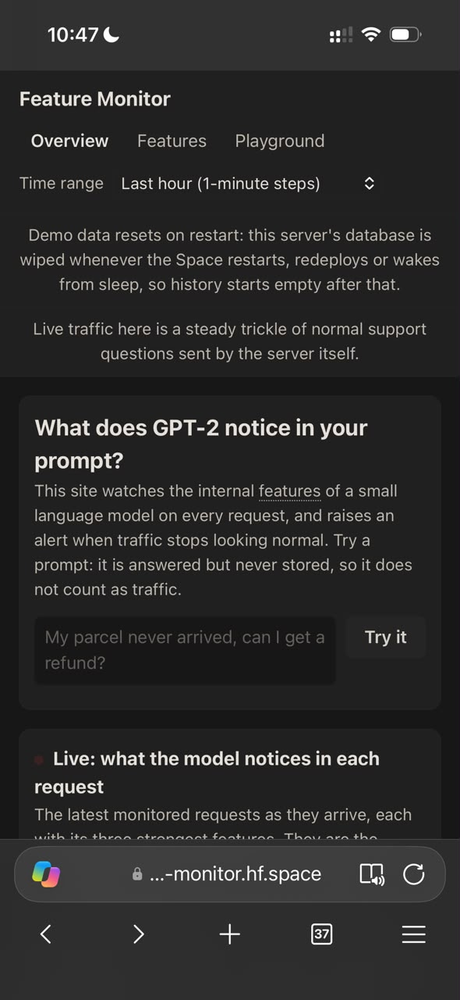
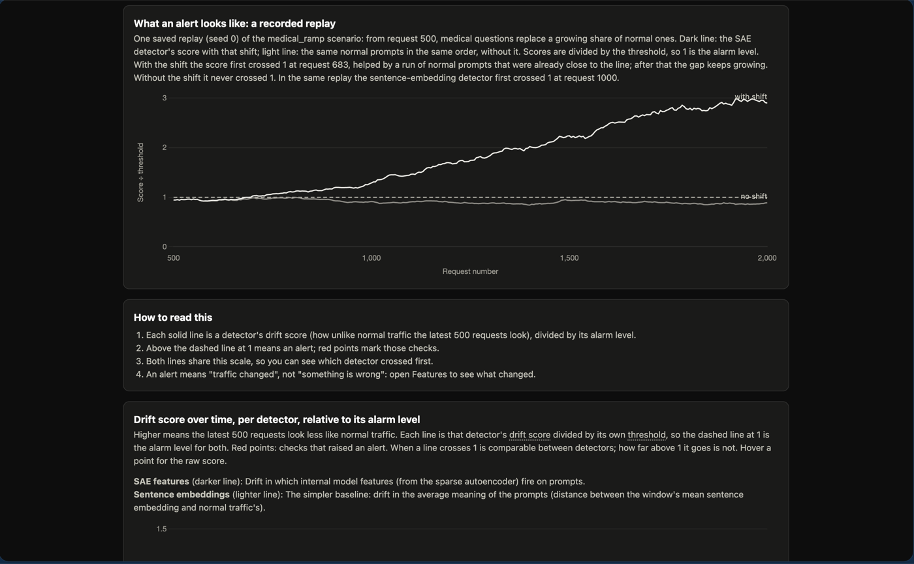
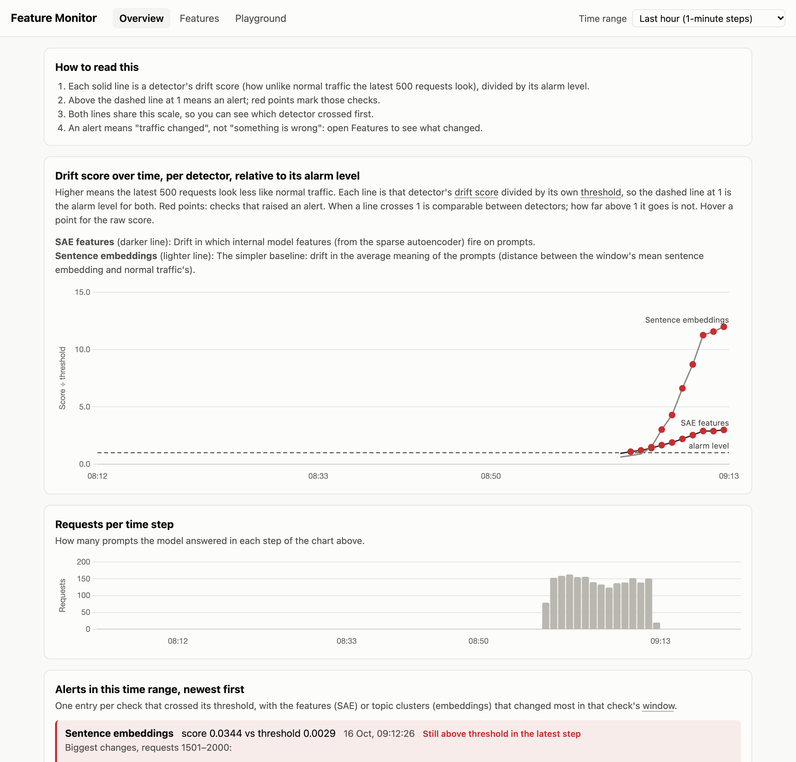
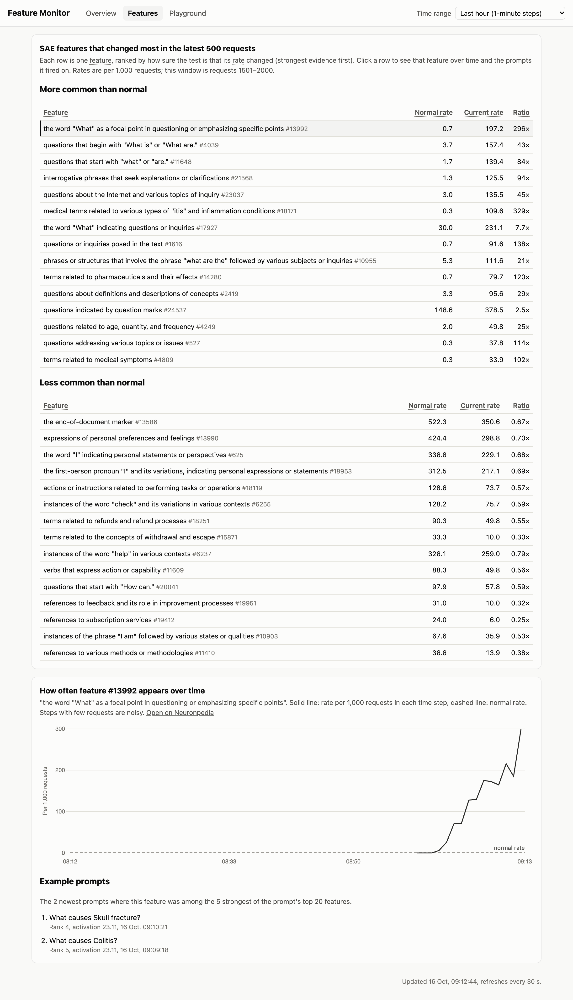
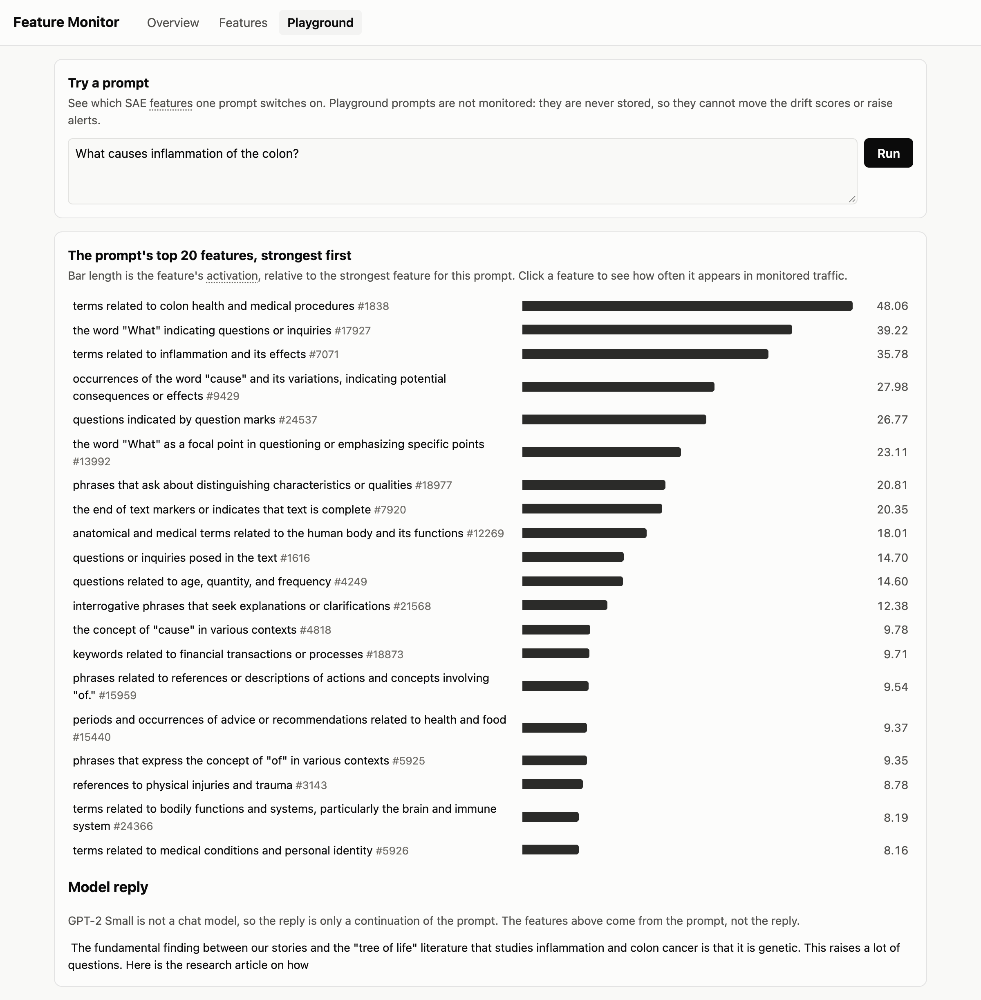

# Feature Monitor

[](https://github.com/shedrachIkenna/feature-monitor/actions/workflows/ci.yml)

## Problem Statement

When a deployed language model starts receiving different requests, or the model itself changes, operators often find out late. Feature Monitor tests whether shifts in one layer's GPT-2 Small activations, encoded as sparse autoencoder features, can flag changes, and compares those alerts with monitoring sentence embeddings of the prompts, calibrated and evaluated the same way. This is an experiment: neither approach is assumed to work better, and results will include null or negative findings.

**Status: in progress**

## Quick Start

```sh
uv sync
uv run pytest
```

The first test run downloads GPT-2 Small and its SAE. `make test-fast` skips the tests that need them.

**Model profiles.** The model, its SAE, the layer read and the Neuronpedia label source come from one profile in `monitor/profiles.yaml`, chosen with `FEATURE_MONITOR_PROFILE`: `gpt2_small` (the default, and what the Space runs) or `gemma2_2b` (Gemma 2 2B with the Gemma Scope layer-16, 16k-feature SAE). Baselines, thresholds, feature caches and labels are kept per profile. Gemma is gated on Hugging Face: accept its licence and log in (`uv run hf auth login`) before loading it. Both profiles have a saved baseline and threshold; Gemma's were built offline with `eval/run_experiment.py`, at bfloat16.

Run the API (loads the model once at startup):

```sh
uv run uvicorn backend.app:app
curl -X POST localhost:8000/chat -H 'content-type: application/json' -d '{"prompt": "Hello"}'
```

Endpoints: `GET /health`, `POST /chat`, `GET /features/recent?limit=50`, `GET /features/stats?minutes=60`, `GET /alerts`, `GET /dashboard/timeline`, `GET /dashboard/drifting`, `GET /dashboard/feature/{id}`, `GET /dashboard/labels?ids=1,2,3`, `GET /dashboard/normal-rates?ids=1,2,3`, `GET /demo/status`, `POST /admin/scenario`.

`POST /chat` stores every request as monitored traffic. Send `"record": false` to get the reply and features without storing anything; the Playground page does this, so trying prompts by hand never moves the drift scores, raises alerts, or shows up as example prompts.

The model answers one prompt at a time. At most 4 `/chat` requests may be running or waiting at once (set `FEATURE_MONITOR_MAX_CHAT_QUEUE` to change it); the rest get `429 Too Many Requests` with `Retry-After: 1` and are neither run nor stored.

Recorded prompts can be locked with a secret so strangers cannot push traffic into the drift window. Set `FEATURE_MONITOR_RECORD_TOKEN` on the server, and send the same value in an `X-Record-Token` header with every `"record": true` request; a missing or wrong token gets `403 Forbidden`. The traffic generator sends the header when `FEATURE_MONITOR_RECORD_TOKEN` is set in its shell. Without a token the server records anything, unless `FEATURE_MONITOR_REQUIRE_RECORD_TOKEN=1` is set, in which case it refuses all recorded prompts. Unrecorded prompts (`"record": false`, the Playground) never need the token.

Unrecorded prompts are also rate limited per client address: 10 per minute by default (set `FEATURE_MONITOR_CHAT_RATE_LIMIT`, e.g. `30/minute`); the next ones get `429` with `Retry-After: 60`. Recorded prompts are exempt, since on the Space they already need the token. Off a Space the address is the direct connection's; on a Space it is the last `X-Forwarded-For` entry, which Hugging Face's proxy adds (the earlier entries come from the caller and can be faked).

**Demo traffic.** With `FEATURE_MONITOR_DEMO_TRAFFIC=1` (the Docker image sets it), a background thread sends normal prompts from the `normal_test` pool straight to the model and stores them with scenario `demo_normal`: as fast as it can until 500 requests are stored, so drift checks can start, then one every 20 seconds (`FEATURE_MONITOR_DEMO_INTERVAL_SECONDS`). It only sends when no `/chat` is running or waiting. `POST /admin/scenario` with `{"name": "medical_ramp"}` (or any file in `traffic/scenarios/`) and an `X-Admin-Token` header matching `FEATURE_MONITOR_ADMIN_TOKEN` runs that scenario through the same thread, pausing the trickle; without that variable the endpoint refuses everything. `GET /demo/status` shows the warm-up and any running scenario, and the dashboard shows both.

Requests, drift checks and alerts older than 7 days are deleted once a day. Every request is logged to stdout as one JSON line (time, method, path, status, total, generation and extraction ms, whether it was recorded), with no prompt text and no client address.

### Open the dashboard

The same server serves the dashboard at `/`. From the project folder:

```sh
uv run uvicorn backend.app:app --port 8000
```

Wait for `Uvicorn running on http://127.0.0.1:8000` (loading GPT-2 and the SAE takes about half a minute), then open <http://localhost:8000/>. Stop it with Ctrl+C.

To look at a saved scenario run instead of live traffic, point the app at that run's database:

```sh
FEATURE_MONITOR_DB=data/dashboard_check/medical_ramp_mean.db uv run uvicorn backend.app:app --port 8000
```

The charts show time up to now, so for a run from earlier in the day set **Time range** to **Last 24 hours**. "address already in use" means another copy of the server is already running on port 8000; stop that one first.

### What it looks like

The live overview on the Space, 18 October (desktop, then phone). It opens with a "Try it" box that shows a prompt's five strongest features with how often each appears in normal traffic (`/dashboard/normal-rates`, per 1,000 baseline prompts), then a live feed of monitored requests as they arrive with their three strongest features. The feed only shows recorded traffic, so visitors' own prompts never appear in it; the labels are Neuronpedia's and some are loose ("wheree could i order…" picks up the word "Whe").





Next comes a recorded replay of `medical_ramp` (seed 0): the SAE score with the shift and for the same normal prompts without it, from `frontend/recorded_example.json`, which `uv run python -m eval.recorded_example` rebuilds from the saved results. (This screenshot predates the label fixes: the dashed line still crosses "no shift".)



The screenshots below come from one `medical_ramp` run (seed 42; 2,000 requests in about 14 minutes, medical questions ramped into normal traffic), not from live traffic, viewed on the 1-hour range before the sections above were added.

The drift chart: each detector's drift score divided by its own threshold, so the dashed line at 1 is the alarm level for both. In this run the SAE detector first alerted at request 780 and the embedding detector at request 1061. How far a line rises above 1 is not comparable between detectors.



The Features page: SAE features that became more and less common in the latest 500 requests, and the rate over time of the top one, #13992 ("What" questions). Most of the top rising features are about question wording, not medicine, because the medical prompts are templated; medical features such as #18171 (inflammation terms) rank lower.



The Playground: the top 20 features for one prompt, typed by hand and not stored.



GPT-2 Small is not a chat model, so `/chat` replies are poor continuations of the prompt. That is expected: reply quality is not what we measure. The replies use a fixed seed (40 new tokens at most), so the same prompt always gets the same reply.

### Run in Docker

The image runs on CPU only and needs no network to start: GPT-2, the SAE, the MiniLM embedder
and the Neuronpedia labels of the 2,488 baseline features are downloaded while the image is
built. Labels of other features are fetched on first use when the network is reachable, and
show "unlabelled" otherwise.

```sh
docker compose up --build
```

The first build takes several minutes. Then open <http://localhost:7860/>;
`curl localhost:7860/health` reports `"device": "cpu"`. The database is
`/data/feature_monitor.db` on the `feature-monitor-data` volume, so it survives
`docker compose down` and rebuilds (`docker compose down -v` deletes it). The app runs as a
non-root user with uid 1000, as Hugging Face Spaces requires.

The image sets `FEATURE_MONITOR_REQUIRE_RECORD_TOKEN=1`, so it refuses recorded prompts until
it is given a token. Locally, `docker-compose.yml` passes `FEATURE_MONITOR_RECORD_TOKEN`
through from your shell (`FEATURE_MONITOR_RECORD_TOKEN=... docker compose up`); on a Hugging
Face Space, add it as a secret in the Space's settings.

On Linux the lock file installs the CPU-only build of torch from the PyTorch index
(`[tool.uv.sources]` in `pyproject.toml`); macOS keeps PyPI's torch. PyPI's Linux torch
brings several GB of NVIDIA CUDA libraries that a CPU container cannot use. On this Mac the
image went from 11.8 GB to 4.06 GB on disk (4.22 GB to 1.22 GB compressed).

**Apple Silicon and amd64.** A Mac with an M-series chip is `arm64` (also called aarch64), so
Docker builds `linux/arm64` images by default. Most servers, including Hugging Face Spaces,
are `linux/amd64` (x86_64). The two run different machine code, so an image built for one
does not run natively on the other. To build for the host:

```sh
docker buildx build --platform linux/amd64 -t feature-monitor:amd64 --load .
docker buildx build --platform linux/amd64,linux/arm64 -t <registry>/feature-monitor --push .
```

The first command builds an amd64 image on the Mac by emulating an x86 CPU, which is slower
than a native build: here about 32 minutes against about 6 for arm64 (not a clean comparison:
the arm64 build reused cached downloads), and the emulated container took 31 seconds to start
against 6 to 9 natively. The second builds both in one multi-platform image
and pushes it to a registry; whoever pulls it gets the variant that matches their machine.
A Hugging Face Docker Space builds the `Dockerfile` itself on amd64, so pushing an image is
not needed there.

### Live demo

The app runs on the Hugging Face Space
[Shedrach/feature-monitor](https://huggingface.co/spaces/Shedrach/feature-monitor). Every
commit on `main` that passes CI is uploaded to it by `.github/workflows/deploy.yml`, and the
Space rebuilds the image. Its disk is not persistent, so the demo data resets whenever the
Space restarts, redeploys or wakes from sleep; the dashboard says so. The demo traffic refills
it: drift checks start once 500 requests are stored again. The YAML block at the
top of this README is the Space's configuration. See [docs/deployment.md](docs/deployment.md)
for how deploys work and how to roll back.

See [docs/design.md](docs/design.md) for the design.

## Offline experiments

Experiments replay the scenarios without the API, from a cache of each prompt's features:

```sh
uv run python -m eval.run_experiment extract calibrate replay   # add verify to check against the saved results
```

`extract` is the only slow step and resumes if stopped; the whole GPT-2 Small run (27,860 prompts) took 12 minutes on this Mac. Results go to `eval/results/experiment_runs.csv`, `experiment_alerts.csv` and `experiment_sweep.csv` (a threshold sweep, so detectors can be compared at equal false-alarm rates); `uv run python -m eval.plot_experiment` draws the sweep for both profiles as `eval/results/experiment_tradeoff.png`. Set `FEATURE_MONITOR_PROFILE` to run another model profile.

`make results` reruns `eval/02_results.ipynb` offline from the cache: the results table per profile, scenario and detector, two figures (`eval/results/fig1_scores.png`, one run's drift scores; `fig2_delays.png`, delay per seed), extraction overhead, failure cases and conclusions. Overhead is the one measurement it reads rather than computes: `uv run python -m eval.latency` writes `eval/results/latency_<profile>.json`.

## Folder Layout

- `backend/` - API and storage
- `monitor/` - feature extraction and drift detection
- `traffic/` - traffic generator and scenario configs
- `eval/` - experiments and results
- `frontend/` - dashboard
- `docs/` - design notes and build log
- `tests/` - tests mirroring the project folders
