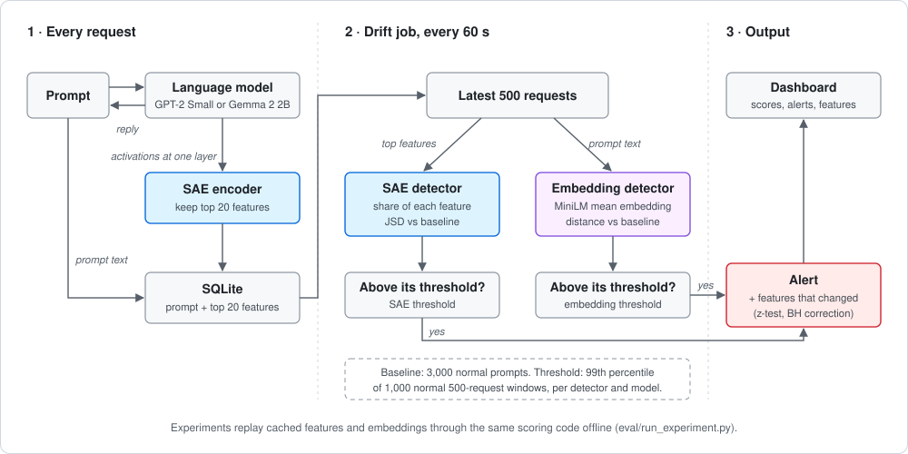
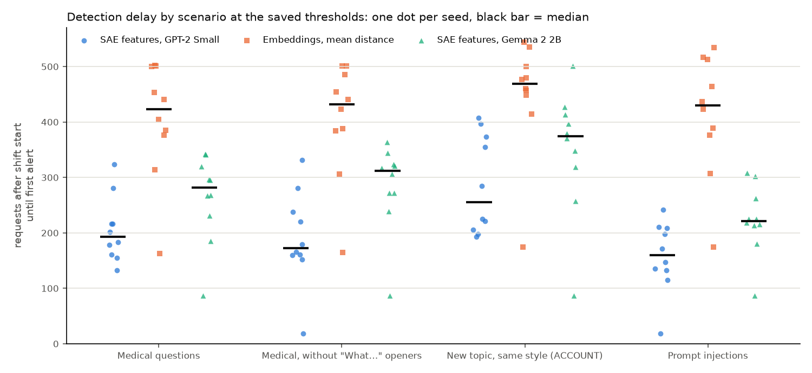

# Feature Monitor: watching a model's SAE features for drift

## Problem

A deployed language model does not see the same traffic forever. A new client starts sending a different kind of question, users push the model toward topics it was not tested on, or someone tries to override its instructions. In this writeup, **drift** means a lasting change in the mix of incoming requests compared with a fixed reference period, the **baseline**. Operators often learn about drift late, from complaints or from a slow slide in downstream metrics.

A cheap and common way to watch for drift is to turn each prompt into a sentence embedding (a fixed-length vector from a small text model) and track how those vectors move over time. This sees only the text. It says nothing about how the deployed model itself represents that text.

This project tests whether the model's own internal state is a more useful signal. Raw activations, the numbers a model computes at a given layer, are hard to use directly, because each dimension mixes many concepts. A **sparse autoencoder (SAE)** is a small network trained to rewrite those activations as a much longer list of numbers, of which only a few are non-zero for any input. Each position in that list is a **feature**: a direction the SAE learned, which often matches something a person can name, such as "references to user accounts". Because few features are active at once, we can store the top 20 per request and count how often each one appears across many requests.

The question is narrow. If the same drift test is applied to SAE feature counts and to prompt embeddings, does either one detect a shift in traffic sooner at a similar false-alarm rate, and what does reading the features cost per request? We did not assume either method would win.

## Approach

We built two drift detectors that differ only in how each request is represented.

**SAE detector.** For each request we read the model's activations at one layer, encode them with a public SAE, and keep the 20 features with the highest activation. For a group of requests, we count how often each feature appears in those top-20 lists. Dividing each count by the total gives a distribution: each feature's share of all top-20 slots.

**Embedding detector.** For each request we embed the prompt text with `all-MiniLM-L6-v2`, a small sentence-embedding model. For a group of requests, we take the mean of their embeddings.

**Baseline and window.** The baseline is 3,000 prompts of normal traffic (`docs/design.md`). The *window* is the latest 500 requests. Each time the window is checked, it gets one score saying how far it is from the baseline (`eval/results/multiseed.json`, `config`):

- SAE: the Jensen-Shannon divergence (JSD) between the baseline's and the window's feature distributions. This is a standard measure of how different two distributions are. It is 0 when they match and at most 1 bit when they share nothing.
- Embeddings: the squared distance between the window's mean embedding and the baseline's mean embedding.

**Threshold.** For each detector we drew 1,000 random 500-prompt windows of normal traffic that were not in the baseline, scored them, and set the alarm threshold at the 99th percentile of those scores. On normal traffic, about 1% of windows should therefore land above the line (`eval/results/multiseed.json`, `config`). Each detector and each model gets its own threshold.

**Alert.** An alert is raised when a window's score rises above the threshold after the previous window was at or below it. A score that stays above the line counts as one alert, but a score that flickers around the line counts as several.

**Why mean distance.** Offline, mean distance detected shifts about as fast as MMD (a kernel-based two-sample test) and faster than counts over 200 topic clusters, and it is the simplest of the three (`eval/results/embed_baselines.json`).

**Fair comparison.** A detector with a lower threshold alerts sooner but also raises more false alarms. So besides the saved 99th-percentile thresholds, we swept each detector's threshold from the 90th to the 100th percentile of its calibration scores. This lets the detectors be compared at equal false-alarm rates (`eval/results/experiment_sweep.csv`).

The SAE detector also runs a per-feature test (a two-proportion z-test, with a Benjamini-Hochberg correction for testing thousands of features at once) to list which features changed. That list is shown to the operator only and never raises an alert.

## System design

The system has two parts: a live service that monitors real requests, and an offline harness that replays the experiments. The results in this writeup come from the offline harness. Both use the same feature extraction and scoring code.

**Models.** The system runs on one model at a time, chosen by a profile (`monitor/profiles.yaml`):

- *GPT-2 Small* (the default): activations at the input to block 8 of 12, encoded with the `gpt2-small-res-jb` SAE (24,576 features).
- *Gemma 2 2B*: activations at the output of block 16 of 26, encoded with the Gemma Scope SAE `layer_16/width_16k/canonical` (16,384 features), loaded at bfloat16, a 16-bit number format that halves memory against 32-bit float32.

Both layers sit about two-thirds of the way through their model, so the two profiles read at a similar relative depth (`docs/design.md`). Feature labels come from Neuronpedia, a public database of SAE feature descriptions. They are shown to operators as hints and are not used in scoring.

**Live path.** For each request, the API runs the model to generate a reply. During the same forward pass it reads the activations, encodes them with the SAE, and stores the request, its reply and its 20 strongest features in SQLite, one row per feature. Every 60 seconds a scheduled job (APScheduler) loads the latest 500 requests and scores them with both detectors. It stores every score, and raises an alert when a score crosses its threshold. The dashboard shows both scores, the alerts and the features that changed most (`docs/schema.md`).

**Deployment.** One CPU-only Docker image, deployed by GitHub Actions to a Hugging Face Docker Space after lint and tests pass. The Space runs GPT-2 Small; Gemma 2 2B has run only in the offline harness.

**Offline harness.** Experiments bypass the API: `eval/run_experiment.py` runs the model once on every prompt any run can use and caches its top 20 features and its MiniLM embedding. For extraction it loads only the blocks up to the SAE's layer. On sampled prompts this gave the same features as the full model: 498 of 498 for GPT-2 and 40 of 40 for Gemma (`docs/log.md`, 2026-10-18). Each scenario and seed is then replayed from the cache through the same scoring code, scoring a window after every request. `eval/02_results.ipynb` (`make results`) rebuilds every table and figure from the cache.

## Experiments

**Traffic.** Normal traffic is customer-support messages from the Bitext dataset. The baseline and thresholds come from one part of it (`normal_train`, 14,017 prompts), and the experiments draw normal prompts from a separate part (`normal_test`, 6,008 prompts) with no overlap. Bitext messages contain unfilled template slots such as `{{Order Number}}`, which a detector could spot by the braces alone. We filled every slot with a seeded random value before use (`docs/datasets.md`).

**Scenarios.** Each scenario is 2,000 requests. The first 500 are all normal. From request 500 to 1,500 the share of shifted prompts rises linearly from 0% to 30%, and then holds at 30% (`traffic/scenarios/`). All four shifts are gradual ramps; none is a sudden switch.

| Scenario | Shifted prompts | What changes |
|---|---|---|
| `normal_only` | none | nothing: the false-alarm control |
| `medical_ramp` | MedQuAD health questions | topic and writing style |
| `medical_nowhat_ramp` | the same, without prompts starting with "What" | topic and style, minus one strong wording cue |
| `new_topic_ramp` | Bitext's held-out ACCOUNT category | topic only, same style |
| `injection_ramp` | deepset prompt injections, English only | the framing of the request |

MedQuAD differs from Bitext in topic but also in style, length and punctuation, so an alert on it shows only that *something* changed. The held-out ACCOUNT category (passwords, registration) keeps the Bitext style and changes only the topic (`docs/datasets.md`). The no-"What" variant exists because 66% of medical prompts start with "What" against about 2% of normal ones (`eval/multiseed.py`).

**Seeds.** Each scenario was run with 10 seeds (0 to 9). A seed decides which normal and shifted prompts are drawn and where the shifted ones fall (`traffic/generate.py`). Runs with the same seed draw the same normal prompts in every scenario, so each shift run has its own `normal_only` twin. Two models, five scenarios, ten seeds and two detectors give 200 runs. The embedding detector's 100 runs are identical under both models, because it reads only the prompt text (`eval/results/experiment_runs.csv`).

**Measures.** We fixed these before the runs:

- *Detection:* whether the detector alerted at any point after the shift started.
- *Delay:* requests from the start of the shift (request 500) to the first alert.
- *False alarms:* alerts per 1,000 requests on `normal_only`, and how many of the 10 normal runs raised any alert.
- *Near the line:* for each first alert, we took the same seed's `normal_only` score for the window with the same normal prompts, divided by the threshold. At 0.95 or more, normal traffic alone was within 5% of alerting, so the shift needed only a small push.
- *Equal false-alarm comparison:* delays and false alarms at every threshold from the 90th to the 100th percentile of each detector's calibration scores (`eval/results/experiment_sweep.csv`).
- *Overhead:* 100 `/chat` requests with extraction on and 100 with it off, per model, on the Mac's CPU (`eval/latency.py`).

## Results

First, the results that are null, negative, or weaker than they look. With 10 seeds per scenario, we report how consistent each difference is, not statistical significance. Gemma 2 2B's SAE detector was slower than GPT-2 Small's in every scenario, so the larger model did not detect sooner. Part of GPT-2's speed is proximity: in 25 of its 40 first alerts, normal traffic alone was already within 5% of the threshold, against 5 of 40 for Gemma and 4 of 40 for embeddings. Neither SAE detector was free of false alarms; each alerted in 2 of 10 normal runs at its saved threshold. Delays varied widely from seed to seed (standard deviations of 59 to 113 requests), and the detectors' ranges overlap (`eval/02_results.ipynb` §1, from `eval/results/experiment_runs.csv`).

**At the saved thresholds.** Every detector caught every shift in all 10 seeds. Mean delay in requests, with the range across seeds (`eval/results/experiment_runs.csv`, summarised in `eval/02_results.ipynb` §1):

| Scenario | GPT-2 SAE | Gemma SAE | Embeddings |
|---|---|---|---|
| `medical_ramp` | 204.9 (133–324) | 263.2 (87–342) | 404.0 (163–502) |
| `medical_nowhat_ramp` | 190.6 (18–331) | 284.6 (87–364) | 404.8 (165–501) |
| `new_topic_ramp` | 286.0 (193–407) | 349.8 (87–501) | 448.9 (174–544) |
| `injection_ramp` | 158.0 (18–242) | 223.5 (87–308) | 413.4 (174–534) |
| False alarms per 1,000 normal requests (runs with any) | 0.35 (2/10) | 0.15 (2/10) | 0.55 (4/10) |

Run by run, the SAE detector alerted before the embedding detector in 38 of 40 runs on GPT-2 and 36 of 40 on Gemma. The topic-only shift (`new_topic_ramp`) was the slowest for all three detectors. Removing the "What" prompts did not slow GPT-2's SAE detector (190.6 against 204.9). Gemma's was slower without them (284.6 against 263.2).

**At equal false-alarm rates** (`eval/results/experiment_sweep.csv`). At the 99.5th percentile, GPT-2's SAE detector and the embedding detector both raised 0.05 false alarms per 1,000 requests (1 of 10 normal runs); median delays were 168.5 to 258.5 requests for SAE against 480 to 529.5 for embeddings. At the 99.9th percentile neither raised any false alarm, and the medians were 207.5 to 306.5 against 521 to 546. Of the swept thresholds, Gemma's SAE detector reached 0.05 per 1,000 only at the 100th percentile, with medians of 238.5 to 442.5. So both SAE detectors stayed faster at equal false alarms, though Gemma's lead on the new topic was small (442.5 against 519).

**Overhead.** Reading and encoding the features added a median of 13.3 ms to a GPT-2 request (+4.3% of total request time) and 207.7 ms to a Gemma request (+6.8%), next to median generation times of 390 ms and 3,542 ms on the Mac's CPU. The 95th-percentile overheads, +18.5% and +15.4%, are less reliable, because generation time itself varied between the two 100-request runs (`eval/results/latency_gpt2_small.json`, `latency_gemma2_2b.json`, via `eval/02_results.ipynb` §4).

## What did not work

**Seed 7 is not a clear win for embeddings, and it is not explained either.** All 6 runs where the SAE detector alerted after the embedding detector use seed 7. In each, normal traffic alone was already at 0.980 to 1.006 of the embedding threshold at its first alert, and the embedding detector's `normal_only` run for seed 7 had already alerted on its own. The two windows we examined held 0.8% shifted prompts. Our hypothesis, not tested further, is that these were embedding false alarms rather than SAE misses (`eval/02_results.ipynb` §5).

**Gemma's fastest alerts were false alarms.** With seed 3, Gemma's SAE detector alerted at request 587 in all four shift scenarios, a delay of 87. Its `normal_only` run crossed at 597 with no shift, so about one shifted prompt tipped a window already at the line. Our "normal alerted first" flag missed this because the normal run crossed later (`docs/log.md`, 2026-10-18).

**Counting rises still counts flicker.** On GPT-2's `normal_only` run with seed 1, one score hovering at the threshold produced 2.5 false alarms per 1,000 requests. For the same reason, a stricter threshold can give *more* false alarms: Gemma's SAE detector had 0.15 per 1,000 at the 99th percentile and 0.50 at the 99.5th (`eval/results/experiment_sweep.csv`).

**The per-feature test was silent in the two seed-7 windows**: no feature changed significantly (adjusted p of 0.72 or more). Two windows at embedding alerts say nothing about SAE alerts (`eval/02_results.ipynb` §5).

**The float32 check could not run.** Float32 Gemma did not fit in this Mac's 16 GB even when cut after block 16, so we never checked whether bfloat16 changes Gemma's top-20 features (`docs/log.md`).

## Limitations

- One layer and one SAE per model, and one embedding model.
- Normal traffic is one templated customer-support dataset. Real traffic is more varied, and its normal scores may sit differently against the threshold.
- Every shift is a gradual ramp to 30%. Sudden switches, style-only changes and changes to the model itself (the steering-vector scenario in `docs/design.md`) were planned but not built.
- 10 seeds per scenario, one baseline sample (seed 0) and one calibration draw per detector.
- An alert is a single threshold crossing; requiring several windows in a row was not tested.
- Gemma ran at bfloat16, offline only. It has not served live traffic.
- Overhead was measured on one Mac's CPU, with 100 requests each way.
- Feature labels come from Neuronpedia and are hints only.

## What I would do next

1. Require *k* windows in a row above the threshold, and rerun the sweep to see whether it removes flicker and near-line alerts without losing the SAE detector's lead.
2. Build the model-change scenario: add a steering vector (a fixed direction added to the model's activations) before the SAE's layer at several strengths. Embeddings cannot see this by design, so it tests what only internal monitoring can do, not a race between the two.
3. Add sudden-switch and style-only scenarios.
4. Run the float32 Gemma check on a cloud GPU (`eval/precision_check.py`).
5. Replay real, non-templated traffic, and pin model revisions so results can be rebuilt exactly.
